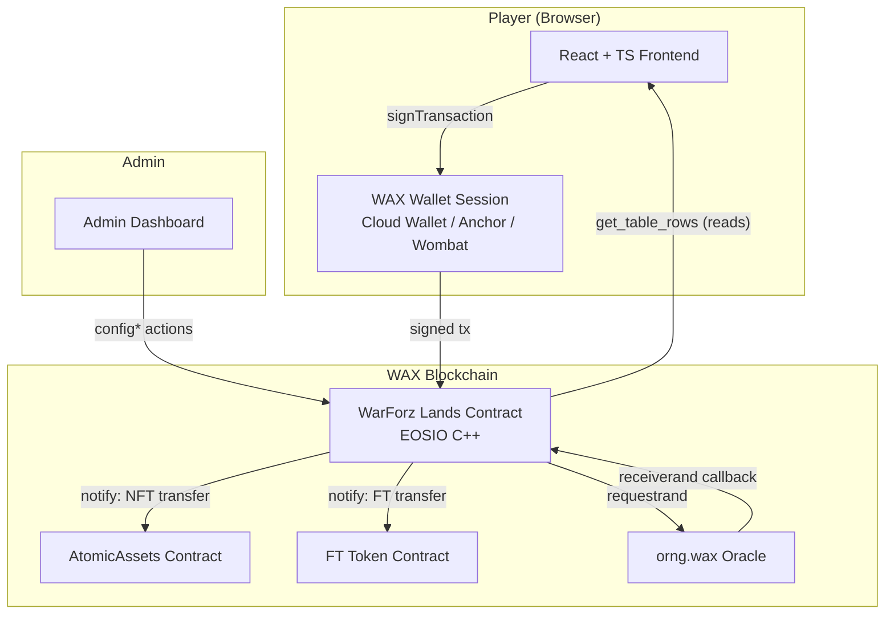
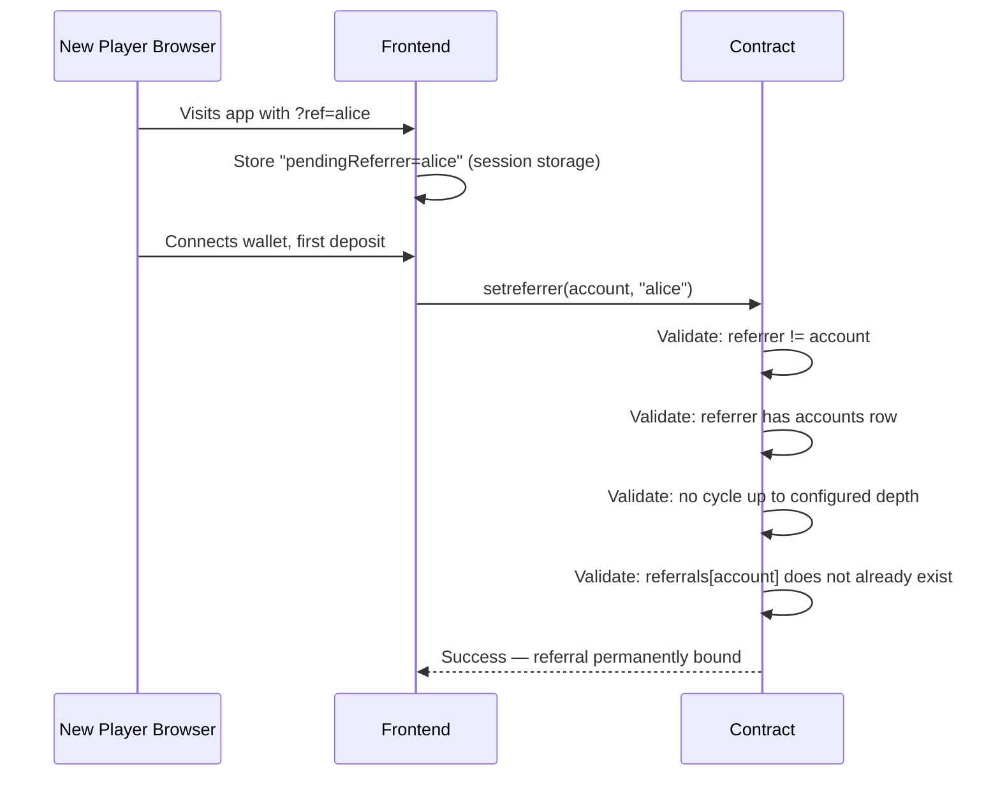

# WARFORZLANDS_MASTER_SPEC.md

**WarForz Lands — Master Game Design & Technical Specification**

Version: 1.0 · Status: Living document (single source of truth) · Chain: WAX Blockchain (EOSIO-family)

Audience: AI coding agents, senior smart-contract engineers, React/frontend engineers, product management, QA, security auditors, and future contributors.

---

## 0. Document Control

| Field | Value |
|---|---|
| Project codename | WarForz Lands (formerly "Mining Game") |
| Blockchain | WAX Blockchain (EOSIO / eosio.cdt) |
| Backend language | C++17, eosio.cdt ≥ 1.7 |
| Frontend stack | React + TypeScript (Next.js), Tailwind CSS |
| NFT standard | AtomicAssets |
| FT standard | Standard `eosio.token`-style contract |
| Randomness | `orng.wax` oracle (async request/callback) |
| Wallets | WAX Cloud Wallet, Anchor, Wombat (via `@wharfkit/session`) |
| Source documents reconciled | `mining_game_contract_plan.md`, `mining_game_frontend_plan.md`, `SECURITY-AUDIT-CHECKLIST.md` |
| Reconciliation approach | Preserve completed/working modules; generalize hardcoded mechanics into admin configuration; extend with missing systems; resolve contradictions explicitly (flagged `⚠ UPDATED MECHANIC`) |

### 0.1 What changed vs. the source documents, and why

The three source documents describe a **hardcoded mining game**: one currency pair (Silver/Gold), one mining type ("mine"), slots purchased with tokens, and gear/land mechanics baked directly into contract logic and struct fields. That implementation is real, tested (phases 0–9 contract, phases 0–7 frontend per the source plans), and largely sound — it is **not** being thrown away.

This spec re-platforms it as **WarForz Lands: a configuration-driven game engine** whose current content pack happens to be a mining theme. Three mechanics are explicitly generalized or changed from the source plans; every other module is preserved as-is with contract/table names kept stable so existing work is not orphaned:

| # | Area | Source-plan behavior | WarForz Lands behavior | Why |
|---|---|---|---|---|
| 1 | **Slot unlocking** | `buylandslot` — pay Silver/Gold from a `landslotcost` price curve | ⚠ **UPDATED MECHANIC** — slots unlock by burning a dedicated **Slot NFT** (`Slot2NFT`, `Slot3NFT`, …), sequentially, no token cost | Explicit product requirement: "Slots are NOT purchased using tokens... each slot requires its own Slot NFT... burned... sequentially." |
| 2 | **Mining** | Single hardcoded mining flow (`mine` action, one reward formula) | Generalized **Mining Type Engine** — `mine(..., mining_type_id)`; every numeric rule (health cost, reward multiplier, NFT bonus, cooldown, failure/death chance, land/gear damage) is a config row, not code | Explicit requirement: mining types (Normal, Dangerous, Dungeon, Boss, Seasonal, Event) must be addable "without smart contract redesign." |
| 3 | **Currencies** | `config.silver_token_contract`, `config.silver_symbol`, `config.gold_template_id` as scalar fields on one `config` singleton | Split into first-class `ftconfig` / `nftconfig` singletons with admin-settable `display_name` | Explicit requirement: never hardcode currencies; admin configures contract/symbol/precision/display name (FT) and collection/schema/template IDs/display name (NFT). |

Everything else — the custody model, the async-RNG pattern, the reward waterfall shape, the crafting engine, cross-player mining with commission, the referral system, the security posture — is **preserved and generalized in place**, not rebuilt. Section 15 gives a full old→new mapping table and a migration note for teams that already deployed phases against the source plans.

---

## 1. Executive Summary

WarForz Lands is a play-to-earn blockchain game on WAX where players deposit NFTs (Miners, Equipment, Land, Slot-unlock NFTs) and a fungible token into a custodial smart contract, and perform **Mining Actions** against activated Land to earn FT rewards and rare NFT drops. The system is deliberately built as a generic engine: nearly every gameplay number lives in an admin-configuration table rather than in code, so new mining types, items, recipes, and events can be shipped by an admin transaction, not a contract redeploy.

**Design North Star:** *If a number can plausibly change after launch, it is not a constant — it is a config row.*

---

## 2. Design Principles (binding on every module below)

1. **Configuration over code.** Currencies, NFT templates, rarities, mining rewards, mining types, crafting recipes, booster values, durability, health, RNG chances, slot unlock requirements, referral rewards, events, and balancing values are NEVER hardcoded. Each has an admin table.
2. **Generic over specific.** When a mining-themed and a generic implementation are both possible, implement the generic one and theme it via config/display data (names, images, descriptors), not via new code paths.
3. **Irreversibility requires friction.** Every action that burns an NFT or permanently destroys value requires an explicit, unambiguous frontend confirmation step, worded exactly per Section 11.7.
4. **Async RNG is a first-class citizen.** Anything using `orng.wax` is a two-phase state machine (request → pending → resolve), never a synchronous return.
5. **Zero-sum economics.** No reward waterfall step may mint value outside its documented formula; every split must sum exactly to the gross with deterministic rounding.
6. **Backward-compatible extension.** New systems (guilds, PvP, rentals, marketplace, upgrades, pets, vehicles, battle pass, leaderboards, additional currencies/NFT types, cross-chain) must be addable as new tables/actions alongside existing ones, never by breaking existing table layouts.
7. **Documentation is part of the definition of done.** Every implemented feature updates this spec (or a versioned addendum) in the same change.

---

## 3. Glossary & Terminology Map

| Term (this spec) | Definition | Source-plan equivalent |
|---|---|---|
| **FT** | The primary fungible token ("Silver" in current content pack). Configurable contract/symbol/precision/display name. | Silver |
| **NFT (currency)** | Rare fungible-role NFT drop ("Gold" in current content pack). Configurable collection/schema/template IDs/display name. | Gold |
| **Miner** | Reusable NFT worker. Has health + cooldown. Freely deposited/withdrawn. | Miner |
| **Equipment / Booster** | Consumable NFT tool. Account-bound on first use. Wears down; burns at zero durability. | Gear |
| **Land** | Consumable NFT arena. Account-bound on activation; burns on removal/depletion. Can be listed for cross-player mining (except Free-to-Play lands). | Land NFT |
| **Free-to-Play (F2P) Land** | A land template flagged `unlimited_durability = true` and `is_freeplay = true`. Never burns. Cannot be listed. Gates allowed Miner type via rotating RNG instead of using durability. Max 1 active per account (admin-configurable cap). | Free-play land |
| **Slot** | Per-player container holding one activated Land. 1 unlocked at registration; up to 5 initial max; more unlockable in future config. | Land slot |
| **Slot-Unlock NFT** | A burn-to-unlock NFT (e.g. `Slot2NFT`) required to unlock the corresponding slot index. ⚠ Replaces token-cost slot purchase from the source plan. | *(new)* |
| **Plot** | A mining position on an activated Land; holds one Miner. | Plot |
| **Mining Type** | A config-driven ruleset (Normal, Dangerous, Dungeon, Boss, Seasonal, Event, …) selected at `mine` time, defining health cost, reward multiplier, NFT bonus, cooldown, failure/death chance, land/equipment damage, and special modifiers. | *(new — generalizes the single hardcoded mining flow)* |
| **Land–Miner Match Bonus** | An admin-configured multiplier applied when a Miner "type" matches a Land "type" (e.g. Fire Miner + Fire Land → +20%). | *(new — generalizes land_bonus)* |
| **Crafting Recipe** | Admin-defined FT/NFT inputs, burn rules, weighted random outputs, success/failure chance. | Craft recipe |
| **Reward Waterfall** | The deterministic split of gross mining reward into platform fee → landlord commission → referral cut → miner-owner net → rare NFT roll → durability/health decrements. | Reward waterfall |
| **Referral** | Single-level, immutable, self/cycle-rejecting referral binding with a configurable reward rate. | Referral |
| **Admin Configuration System** | The set of all admin-only tables/actions described in Section 10. | *(implicit across source docs; now consolidated)* |

---

## 4. System Architecture Overview



**Layering:**

- **Custody layer** — the contract holds all deposited NFTs and FT on behalf of players; nothing in a player's own wallet is directly game-usable until deposited.
- **Configuration layer** — every gameplay-affecting number lives in an admin table (Section 10), read by both the contract at resolution time and the frontend for client-side pre-checks/UX.
- **Action layer** — player actions mutate player-scoped state and, where randomness is involved, only *request* an outcome; they never resolve rewards synchronously.
- **Oracle layer** — `orng.wax` is the sole source of unpredictable randomness; `receiverand` is the only code path allowed to credit RNG-dependent rewards.
- **Presentation layer** — the frontend never contains gameplay logic beyond client-side pre-validation (a UX nicety); the contract is authoritative for every rule.

---

## 5. Authentication & Onboarding

### 5.1 Login

Players authenticate exclusively via WAX Wallet session (`@wharfkit/session`), supporting WAX Cloud Wallet, Anchor, and Wombat plugins behind one unified `signTransaction()` helper (Section 12.2).

### 5.2 Signup

Signup is implicit — it happens the moment an account's first FT deposit or Miner/Land/Equipment deposit notification is processed by the contract (see `on_notify` handlers, Section 9.6). This auto-creates the player's `accounts` row and default `landslots[slot_index=1]` (unlocked, empty).

### 5.3 Referral capture

The signup URL may contain `?ref=<username>`. Flow:



**Rules (all admin-configurable via `config`):**
- Self-referral rejected.
- Referral binding is **one-time and immutable** — `referrals` is append-only.
- Cycle rejection up to a configurable depth (default 10).
- Referral reward rate is a config value (`config.referral_rate`), bounded `[0, 20]%` by default, admin-adjustable within bounds enforced at `configset` time.
- If the referrer's `accounts` row is later deleted/missing at reward time, the cut silently falls through to the miner-owner instead of failing the whole mine resolution (see Section 9.4, invariant H6-equivalent).

---

## 6. Currency System

Two currencies, both configurable, never hardcoded.

### 6.1 FT ("Silver" by default theme)

| Config field (`ftconfig` singleton) | Type | Notes |
|---|---|---|
| `contract` | `name` | The FT token contract account (e.g. `eosio.token`-style). |
| `symbol` | `symbol` | Includes precision, e.g. `4,SILVER`. |
| `display_name` | `string` | Shown in UI; independent of on-chain symbol. |
| `fee_account` | `name` | Receives platform fee on withdrawal / mining. |
| `withdraw_fee_pct` | `double` | Bounded `[0, 20]` at `configset` time. |

### 6.2 NFT currency ("Gold" by default theme)

| Config field (`nftconfig` singleton) | Type | Notes |
|---|---|---|
| `collection` | `name` | AtomicAssets collection accepted by the contract for currency-role NFTs. |
| `schema` | `name` | Schema within the collection used for the currency NFT. |
| `template_ids` | `vector<int32_t>` | One or more template IDs that count as "the NFT currency" (supports tiered Gold in future — e.g. Gold Nugget vs Gold Bar). |
| `display_name` | `string` | Shown in UI. |

### 6.3 Rules

- All FT arithmetic in the contract reads `ftconfig.symbol` — no literal `symbol("SILVER", 4)` anywhere in reward-path code.
- All NFT-currency minting (rare drops) references `nftconfig` — never a bare literal template ID in `resolve_mine`/`resolve_craft`.
- Admins may add additional currencies in future (Section 14) by adding new config singleton(s) of the same shape; the reward-waterfall and crafting engines must read currency identity from config, never assume "FT" or "NFT" means specifically Silver/Gold.

---

## 7. Slots

### 7.1 Rules

- Every player starts with **1 unlocked slot** (`slot_index = 1`) at registration (first deposit).
- Maximum **initial** slot count is **5**. Future content packs may raise this via new `slotconf` rows — the contract must not hardcode a max of 5 anywhere; 5 is simply how many `slotconf` rows the admin seeds at launch.
- ⚠ **UPDATED MECHANIC:** Slots are **not purchased with tokens**. Each slot (index 2–5, and beyond in future) requires burning its own dedicated **Slot-Unlock NFT** (e.g. `Slot2NFT` for slot 2).
- Slots unlock **strictly sequentially** — a player cannot unlock slot 4 before slot 3, and cannot skip slots.
- The Slot-Unlock NFT is **burned** on successful unlock (never returned).

### 7.2 Admin configuration — `slotconf` (key = `slot_index`)

| Field | Type | Notes |
|---|---|---|
| `slot_index` | `uint32_t` | 1 = default free slot (no NFT needed, auto-unlocked at registration); 2..N require an NFT. |
| `template_id` | `int32_t` | AtomicAssets template ID of the Slot-Unlock NFT required for this index. Ignored/unused for index 1. |
| `enabled` | `bool` | Whether this slot tier is currently unlockable (allows admin to stage future slots without exposing them). |
| `burn_rule` | `uint8_t` (enum) | `BURN_ALWAYS` (default) — reserved enum for future non-burn unlock mechanics without a table redesign. |

### 7.3 Action: `unlockslot(owner, slot_index, asset_id)`

```
Guards: require_auth(owner), check_not_maintenance(), check_tos_accepted(owner)

1. slotconf[slot_index] must exist and enabled == true.
2. slot_index must equal accounts[owner].unlocked_land_slots + 1 (strict sequential; no skipping).
3. deposits[asset_id] (scope=owner) must exist with template_id == slotconf[slot_index].template_id.
4. Erase deposits[asset_id]; inline atomicassets::burnasset(owner-authorized custody burn — see 13.4 burn ordering rule).
5. Increment accounts[owner].unlocked_land_slots.
6. Insert new landslots[slot_index] row (land_asset_id = 0, empty), RAM paid by owner.
```

This **replaces** `buylandslot(owner)` and the `landslotcost` table from the source contract plan. `landslotcost` is removed from the table list; any already-deployed instance of the source contract must run the migration in Section 15.3.

---

## 8. Lands

### 8.1 Rules

- A player places one Land into one Slot via `activateland`.
- The Land NFT is **burned during activation** and never returns — even if later "removed" from the slot, it is gone (removal just clears the slot; the burn already happened at activation, matching the source contract's design where deposit→activate is the custody move and depletion/removal burns the NFT).
- Lands carry: `rarity`, `durability` (or `unlimited_durability` flag), mining bonuses, compatible Miner list/types, mining-type restrictions, and Land–Miner match bonuses.
- **Free-to-Play (F2P) Lands:** `unlimited_durability = true`. Instead of durability loss, F2P lands gate which **Miner type** may mine there via a rotating RNG window (see 8.4). Cannot be listed for cross-player mining. Max 1 active per account (admin-configurable via `config.max_freeplay_lands_per_account`, default 1).

### 8.2 Admin configuration — `landconf` (key = `template_id`)

| Field | Type | Notes |
|---|---|---|
| `template_id` | `int32_t` | AtomicAssets template ID. |
| `rarity` | `uint32_t` | |
| `durability_max` | `uint32_t` | Ignored (store 0) if `unlimited_durability = true`. |
| `unlimited_durability` | `bool` | True for F2P lands. |
| `is_freeplay` | `bool` | True for F2P lands; drives listing restriction and RNG-gate behavior. |
| `land_type` | `name` | Generic type tag (e.g. `fire`, `ice`, `stone`) used for Land–Miner Match Bonus lookups. |
| `land_bonus` | `double` | Base reward multiplier contributed by this land. |
| `compatible_miner_types` | `vector<name>` | Empty = all types allowed (subject to F2P RNG gate if applicable). |
| `compatible_mining_types` | `vector<uint32_t>` | Mining Type IDs (Section 9.4) permitted on this land. Empty = all enabled types permitted. |

### 8.3 `landdef` (display/cosmetic, key = `template_id`)

`land_name`, `rarity_label`, `img` — display-only, never read by reward logic.

### 8.4 Land–Miner Match Bonus — `landminermatch` (key = composite `land_type` + `miner_type`)

| Field | Type | Notes |
|---|---|---|
| `land_type` | `name` | |
| `miner_type` | `name` | |
| `bonus_multiplier` | `double` | Applied multiplicatively in the reward formula (Section 9.5) when a Miner of `miner_type` mines on a Land of `land_type`. Default 1.0 (no bonus) if no row exists for a pair. |

Example: `(land_type=fire, miner_type=fire, bonus_multiplier=1.20)` → +20% reward, matching the example in the product brief.

### 8.5 Free-to-Play RNG gate — `freeplaystate` (singleton)

| Field | Type | Notes |
|---|---|---|
| `current_allowed_selector` | `name` | Generalizes "rarity" from the source plan to any Miner-type selector the admin configures (rarity tier, elemental type, etc. — chosen via `fpselectorconf`, 8.6). |
| `window_ends_at` | `time_point_sec` | |
| `rotation_assoc_id` | `uint64_t` | Pending RNG request driving the next rotation. |

### 8.6 `fpselectorconf` (weighted rotation pool, key = `selector_value`)

| Field | Type | Notes |
|---|---|---|
| `selector_value` | `name` | A Miner-type or rarity value eligible to be rolled. |
| `weight` | `uint32_t` | Relative selection weight. |
| `rotation_period_sec` | `uint32_t` | How long a rolled selector stays active before the next roll (config-level default, can vary per admin update). |

This generalizes the source plan's hardcoded "miner-rarity RNG gate" and `fprarityweights` table into a selector-agnostic weighted rotation, so a future content pack could gate F2P land by elemental type, class, or any other Miner attribute without a table redesign.

---

## 9. Miners, Equipment, and the Mining Engine

### 9.1 Miners — `minerconf` (key = `template_id`)

| Field | Type | Notes |
|---|---|---|
| `template_id` | `int32_t` | |
| `miner_type` | `name` | Generic type tag for match-bonus lookups (e.g. `fire`). |
| `rarity` | `uint32_t` | Bounded `[1, MAX_RARITY]` at `minerset` time. |
| `health_max` | `uint32_t` | |
| `base_reward_rate` | `double` | |
| `base_nft_drop_rate` | `double` | Base chance contributing to the rare NFT-currency roll; modified per mining type (9.4). |
| `cooldown_sec` | `uint32_t` | |
| `compatible_land_types` | `vector<name>` | Empty = compatible with all. |
| `compatible_equipment_types` | `vector<name>` | Empty = compatible with all. |

Miners are **reusable** — freely deposited and withdrawn (subject to not being currently placed or in an active mine/occupancy record).

### 9.2 Equipment / Boosters — `equipconf` (key = `template_id`)

| Field | Type | Notes |
|---|---|---|
| `template_id` | `int32_t` | |
| `equipment_type` | `name` | Generic type tag. |
| `rarity` | `uint32_t` | |
| `durability_max` | `uint32_t` | |
| `reward_boost` | `double` | Multiplicative reward contribution. |
| `nft_drop_boost` | `double` | Additive/multiplicative contribution to NFT-currency drop chance (documented sign/operator per Section 9.5). |
| `compatible_miner_types` | `vector<name>` | Empty = all. |
| `compatible_mining_types` | `vector<uint32_t>` | Empty = all enabled. |

Equipment NFTs are **burned when equipped** (account-bound, consumable) and **cannot be unequipped** — only removed (which is itself destructive and burns remaining value; see Section 11.7 warning copy). Durability decreases per mine; destroyed (burned + row erased) at zero.

### 9.3 Mining flow

```mermaid
flowchart LR
    A[Select Slot] --> B[Select Miner]
    B --> C[Select Equipment]
    C --> D[Select Mining Type]
    D --> E[Mine action fired]
    E --> F[orng.wax RNG request]
    F --> G[receiverand callback]
    G --> H[Resolve: reward, NFT roll, failure/death roll]
    H --> I[Update health / durability]
    I --> J[Write history / logmine]
    J --> K[Frontend: reward + optional NFT-drop animation, skippable]
```



The `mine` action never resolves rewards synchronously — only `receiverand` does (Section 13.3). The frontend must show a pending state and poll until resolution.

### 9.4 Mining Types — the generalized engine

**This is the core architectural change from the source plan.** Instead of one hardcoded mining flow, every mine session selects a `mining_type_id`, and the contract looks up a `miningtypeconf` row to parameterize the entire resolution. New types (Dangerous Mining, Dungeon, Boss, Seasonal, Event, and anything conceived after launch) are added by an admin `mtypeset` transaction — never a contract redeploy.

**`miningtypeconf` (key = `mining_type_id`):**

| Field | Type | Notes |
|---|---|---|
| `mining_type_id` | `uint32_t` | 1 = "Normal Mining" (seeded at genesis; matches current live behavior). |
| `name` | `string` | Display name. |
| `enabled` | `bool` | Admin can disable a type (e.g. retire a seasonal event) without deleting history. |
| `health_cost` | `uint32_t` | Health consumed per attempt. |
| `reward_multiplier` | `double` | Multiplies the base gross reward formula (9.5). |
| `nft_drop_bonus` | `double` | Added to (or multiplies, per documented convention — see 9.5) the base NFT-currency drop chance. |
| `cooldown_sec` | `uint32_t` | Overrides/combines with Miner's base cooldown per documented rule (max of the two, by default). |
| `failure_chance` | `double` | `[0,1]`. Rolled first; on failure, no reward is granted (partial refund behavior configurable via `special_modifiers`). |
| `death_chance` | `double` | `[0,1]`. Independent roll; on hit, destroys (burns) the Miner NFT outright — beyond normal durability wear. Default 0 for Normal Mining. |
| `land_damage_multiplier` | `double` | Multiplies the land's normal per-mine durability loss. |
| `equipment_damage_multiplier` | `double` | Multiplies equipment's normal per-mine durability loss. |
| `special_modifiers` | `vector<Modifier>` | Generic `{key: name, value: string}` pairs reserved for type-specific mechanics not yet designed (e.g. `dungeon_key_template_id`, `boss_id`, `season_id`, `partial_refund_pct_on_fail`). The mine/resolve code reads well-known keys defensively (missing key = feature not active for this type) so new modifiers never require a schema migration. |

**Seed data at launch:** exactly one row, `mining_type_id = 1, name = "Normal Mining", failure_chance = 0, death_chance = 0, reward_multiplier = 1.0, ...` — reproducing today's only mining flow with zero behavior change. Every future mining type (Dangerous, Dungeon, Boss, Seasonal, Event) is additive.

### 9.5 Reward formula (generalized)

```
gross = miner.base_reward_rate
        × equipment.reward_boost            (1.0 if no equipment)
        × land.land_bonus
        × landminermatch.bonus_multiplier    (1.0 if no match row)
        × miningtype.reward_multiplier
```

Resolution order inside `resolve_mine`:

1. Roll `failure_chance` (mining-type). On failure → grant 0 reward (or the type's configured partial-refund modifier), still apply health/durability costs, still log, return early.
2. Roll `death_chance` (mining-type). On hit → burn the Miner NFT (in addition to any waterfall below), log a death event, still apply the reward waterfall for whatever was already earned this attempt if the type's modifiers say so (documented per type; default: death voids reward).
3. Compute `gross` per the formula above.
4. Apply the **Reward Waterfall** (identical shape to the source plan, now parameterized only by config, no code path changes):
   1. Platform fee → `ftconfig.fee_account` (using `ftconfig.withdraw_fee_pct`, or a distinct `config.mining_fee_pct` — **CONFIRM** which fee field governs mining vs. withdrawal; the source plan used a single `config.fee` for both. Recommendation: **keep them separate** — `config.mining_fee_pct` for the mining waterfall, `ftconfig.withdraw_fee_pct` for `wdrawft` — since they are economically distinct levers.)
   2. If `land_owner != miner_owner`: landlord commission % (captured from `lands.commission_rate` **at `mine` time**, not `resolve` time — see H9 in Section 13 security) → land_owner.
   3. Referral cut (config `referral_rate`) of miner_owner's remaining share → referrer, if bound and referrer's account still exists.
   4. Remainder → miner_owner's FT balance.
   5. Rare NFT-currency roll: `base_nft_drop_rate × (1 + equipment.nft_drop_boost) + miningtype.nft_drop_bonus` (exact operator combination documented once and applied consistently; see Section 13 F10/F11 for deterministic RNG-byte consumption) → mint via inline AtomicAssets `mintasset` to miner_owner, referencing `nftconfig`.
5. Decrement land durability by `1 × miningtype.land_damage_multiplier` (skip entirely if `land.unlimited_durability`); burn + erase if it reaches zero.
6. Decrement each equipped item's durability by `1 × miningtype.equipment_damage_multiplier`; burn + erase at zero.
7. Decrement Miner health by `miningtype.health_cost`; set cooldown `available = now + max(miner.cooldown_sec, miningtype.cooldown_sec)`.
8. Inline `logmine(...)` with full breakdown (gross, each cut, mining_type_id, failure/death roll outcomes) for auditability and frontend receipt rendering.

No step may leave the sum of all cuts + remainder ≠ gross (Section 13, C4-equivalent invariant, now additionally covering the failure/death branches).

### 9.6 Healing

`heal(owner, miner_id, amount)` — unchanged from the source plan: cost = `amount × minerconf.health_cost_per_point` (an FT `asset`, admin-configured per Miner template), debited from the player's FT balance, health increased and clamped at `health_max`.

---

## 10. Crafting

Preserved from the source plan (already fully data-driven — no generalization needed).

### 10.1 Recipe shape

- **Required FT** — one or more `ReqFT { symbol, amount }`.
- **Required NFTs** — one or more `ReqNFT { template_id, quantity, burn: bool }` — burned on craft or moved to a locked state if `burn = false` (design allows recipes that consume without destroying, e.g. "prove you own X" recipes).
- **Success/failure chance** — resolved via the same async-RNG pattern as mining.
- **Outputs** — weighted random `Res` items (FT credit or NFT mint), resolved via `craftrules`/`RuleItem` weighted rolls, claimed via `craftclaim`.

### 10.2 Tables (unchanged names/shapes from source plan)

`craftrecipes` (scoped/keyed by `category`, `recipe_id`), `craftrules` (`rule_id`), `craftcounts` (`template_id`), plus admin CRUD: `ruleset/ruledel`, `ruleitemadd/ruleitemdel`, `recset/recdel`, `recreqaddft/recreqaddnft/recreqdel`, `recresadd/recresdel`.

### 10.3 Flow

```
craft(owner, category, recipe_id, asset_ids)
  → validate window [start_ms, end_ms], debit FT inputs, burn/lock NFT inputs
  → insert crafts row (status = pending)
  → request_random(owner, "craft", crafts_row_pk)

receiverand → resolve_craft(assoc_id, random_value)
  → walk recipe.results (rule_ids), roll weighted RuleItem per rule using documented byte offsets
  → append resolved items, set status = claimable

craftclaim(owner, assoc_id)
  → mint/transfer each resolved Res, increment craftcounts, log, erase crafts row
```

---

## 11. Admin Configuration System

Every module above has a corresponding admin table. This section is the consolidated index an AI coding agent (or auditor) should use to verify nothing gameplay-relevant was hardcoded.

| Domain | Table(s) | Key admin actions |
|---|---|---|
| **Currencies** | `ftconfig`, `nftconfig` (singletons) | `ftconfigset`, `nftconfigset` |
| **Global config / maintenance** | `config` (singleton) | `configset`, `configclear`, `maintset(bool)` |
| **Terms of Service** | `tosconfig`, `tosuser` | `tosset`, `tosdel` |
| **Slots** | `slotconf` | `slotconfset`, `slotconfdel` |
| **Lands** | `landconf`, `landdef`, `landminermatch` | `landset/landdel`, `landdset/landddel`, `matchbonusset/matchbonusdel` |
| **Free-to-Play rotation** | `freeplaystate` (singleton), `fpselectorconf` | `fpstart()`, `fpselectorset/fpselectordel` |
| **Miners** | `minerconf` | `minerset/minerdel` |
| **Equipment / Boosters** | `equipconf` | `equipset/equipdel` |
| **Mining Types** | `miningtypeconf` | `mtypeset/mtypedel` |
| **Crafting** | `craftrecipes`, `craftrules`, `craftcounts` | `ruleset/ruledel`, `recset/recdel`, `recreqadd*/recreqdel`, `recresadd/recresdel` |
| **Reward pools / drop tables** | reuses `miningtypeconf.special_modifiers` + `craftrules` for anything beyond the base FT/NFT waterfall (avoids a parallel, redundant table) | — |
| **Referral** | `config.referral_rate`, `referrals` (append-only ledger, not directly admin-editable) | `configset` |
| **Maintenance** | `config.maintenance_mode` | `maintset(bool)` |
| **Seasonal Events** | `miningtypeconf` rows with a `season_id` special modifier + `start_ms`/`end_ms` window (reuses crafting's window pattern) | `mtypeset` |
| **Future expansions** | New tables added per Section 14, following the same "config table + admin CRUD" pattern | — |

**Rule for AI coding agents:** before adding a hardcoded gameplay constant anywhere, check this table. If the value doesn't have a home, add one here (schema + admin action) before writing the code that consumes it.

---

## 12. Smart Contract Architecture

### 12.1 Custody & core hierarchy

**player → land slots → activated Land NFT → plots → Miner NFT (+ optional Equipment NFT)**, unchanged from the source plan. Language C++17, eosio.cdt ≥ 1.7, target chain WAX.

### 12.2 Complete table list

Field names/types are authoritative — an implementing agent must not rename, reorder, or omit fields without flagging it in a `PHASE-N-REPORT.md` and stopping for human confirmation, per the golden rules (12.7).

**Contract-scoped (`scope = _self`):**

| Table | Key | Fields (summary) |
|---|---|---|
| `config` | singleton(0) | `maintenance_mode: bool`, `collection_name: name`, `mining_fee_pct: double`, `referral_rate: double`, `next_assoc_id: uint64_t`, `max_freeplay_lands_per_account: uint32_t`, `referral_cycle_depth: uint32_t` |
| `ftconfig` | singleton(0) | contract, symbol, display_name, fee_account, withdraw_fee_pct |
| `nftconfig` | singleton(0) | collection, schema, template_ids, display_name |
| `tosconfig` | `version` | version, tos text |
| `slotconf` | `slot_index` | template_id, enabled, burn_rule |
| `landconf` | `template_id` | rarity, durability_max, unlimited_durability, is_freeplay, land_type, land_bonus, compatible_miner_types, compatible_mining_types |
| `landdef` | `template_id` | land_name, rarity_label, img |
| `landminermatch` | composite(`land_type`,`miner_type`) | bonus_multiplier |
| `minerconf` | `template_id` | miner_type, rarity, health_max, base_reward_rate, base_nft_drop_rate, cooldown_sec, compatible_land_types, compatible_equipment_types, health_cost_per_point (asset) |
| `equipconf` | `template_id` | equipment_type, rarity, durability_max, reward_boost, nft_drop_boost, compatible_miner_types, compatible_mining_types |
| `miningtypeconf` | `mining_type_id` | name, enabled, health_cost, reward_multiplier, nft_drop_bonus, cooldown_sec, failure_chance, death_chance, land_damage_multiplier, equipment_damage_multiplier, special_modifiers |
| `fpselectorconf` | `selector_value` | weight, rotation_period_sec |
| `freeplaystate` | singleton(0) | current_allowed_selector, window_ends_at, rotation_assoc_id |
| `craftrecipes` | `recipe_id` (sub-scoped by `category`) | req_ft[], req_nft[], results[] (rule_ids), start_ms, end_ms |
| `craftrules` | `rule_id` | items[] (RuleItem: weight + Res), total_weight |
| `craftcounts` | `template_id` | count minted |
| `rngassocs` | `assoc_id` | assoc_type, owner, context_id, request_time |
| `referrals` | `referee` | referrer, set_at (append-only) |

**Player-scoped (`scope = owner`):**

| Table | Key | Fields (summary) |
|---|---|---|
| `accounts` | singleton(0) | account, balances (vector<asset>), unlocked_land_slots, created_at |
| `landslots` | `slot_id` | land_asset_id (0 = empty) |
| `lands` | `asset_id` | template_id, slot_id, durability_remaining, is_listed, commission_rate |
| `miners` | `asset_id` | template_id, health, available (cooldown timestamp), plot_id (0 = not placed) |
| `equipment` | `asset_id` | template_id, durability_remaining, available, miner_asset_id (0 = unattached) |
| `mines` | `assoc_id` | land_owner, land_slot, plot_id, miner_asset_id, equipment_asset_ids[], mining_type_id |
| `crafts` | `assoc_id` | category, recipe_id, rng_seed, status, items[] |
| `deposits` | `asset_id` | template_id, schema_name, collection_name |

**Cross-account occupancy (`scope = land_owner`):**

| Table | Key | Fields |
|---|---|---|
| `occupancy` | `miner_asset_id` | miner_owner, land_asset_id, land_slot, plot_id, active_assoc_id |

> `landslotcost` from the source plan is **removed** — replaced by `slotconf` (Section 7.2). `gear`/`gearconf` are renamed `equipment`/`equipconf` for clarity; if an already-deployed contract used the old names, treat this as a table rename requiring a migration action (Section 16.3), not a silent field remap.

### 12.3 Complete action list

**Admin** (`require_auth(_self)`):
`configset/configclear/maintset`, `ftconfigset`, `nftconfigset`, `tosset/tosdel`, `slotconfset/slotconfdel`, `landset/landdel`, `landdset/landddel`, `matchbonusset/matchbonusdel`, `minerset/minerdel`, `equipset/equipdel`, `mtypeset/mtypedel`, `fpselectorset/fpselectordel`, `fpstart()`, `ruleset/ruledel`, `ruleitemadd/ruleitemdel`, `recset/recdel`, `recreqaddft/recreqaddnft/recreqdel`, `recresadd/recresdel`.

**Player** (`require_auth(owner)` unless noted):
`tosaccept(account)`, `setreferrer(account, referrer)`, `unlockslot(owner, slot_index, asset_id)`, `activateland(owner, land_slot, land_asset_id)`, `removeland(owner, land_slot)`, `mineradd/minerrem(owner, plot_id, miner_id)`, `equipadd/equiprem(owner, miner_id, equip_id)`, `listland/unlistland(owner, land_slot, [commission_rate])`, `mine(miner_owner, land_owner, land_slot, plot_id, miner_id, mining_type_id)`, `heal(owner, miner_id, amount)`, `craft(owner, category, recipe_id, asset_ids)`, `craftclaim(owner, assoc_id)`, `wdrawminer(owner, asset_ids)`, `wdrawft(owner, quantity, fee)`.

**System** (never called externally): `receiverand(assoc_id, random_value)` — `require_auth("orng.wax"_n)`; `logmine`, `logcraft`, `logheal` — `require_auth(_self)`, inline logs only.

**Notification-based:** `on_notify("atomicassets::transfer")`, `on_notify("<ft_contract>::transfer")`.

### 12.4 Invariants (must hold after every transaction)

1. Sum of all FT in `accounts[*].balances` + pending-out ledger == FT held by the contract account (accounting identity).
2. Every `miners.plot_id != 0` has a matching placement record (own-land implicit, or an `occupancy` row for cross-player).
3. Every `lands.is_listed == true` refers to a land whose template `is_freeplay == false`.
4. `accounts[*].unlocked_land_slots >= 1` for any account that has ever accepted ToS.
5. At most `config.max_freeplay_lands_per_account` `lands` rows per account have `is_freeplay == true`.
6. Every `rngassocs` row corresponds to an active `mines` row, `crafts` row, or the free-play rotation.
7. No Miner referenced by an active `mines`/`occupancy` row can be withdrawn.
8. `referrals` is append-only.
9. `equipment.miner_asset_id != 0` iff currently equipped; equipped equipment can never be burned via a different Miner's `equiprem`.
10. `durability_remaining == 0` (for non-`unlimited_durability` items) implies the row was deleted and the NFT burned in the same transaction.
11. **(new)** Every `mines` row carries a `mining_type_id` that exists in `miningtypeconf` and is `enabled == true` at `mine` time.
12. **(new)** A Land's `unlimited_durability == true` implies no `durability_remaining` decrement ever occurs for it, in any mining type.

### 12.5 Randomness (async, unchanged pattern)

`mine` and `craft` request randomness from `orng.wax`; a unique `assoc_id` is stored in `rngassocs`; `receiverand` dispatches by `assoc_type` and is the **only** code path that credits RNG-dependent outcomes. Signing value mixes `assoc_id ^ time ^ owner.value` — never predictable.

### 12.6 Contract-level security requirements (non-negotiable)

- Every action starts with `require_auth(the_correct_account)` — never trust a parameter alone.
- Every arithmetic operation on rewards uses `int128_t` intermediate or `asset`'s checked ops — no raw `uint64_t` multiplication of large values.
- `receiverand` verifies `require_auth("orng.wax"_n)` and that the `assoc_id` exists before doing anything.
- On any early-return failure inside `receiverand`, no `mines`/`crafts` row is left stuck — either resolved (even unfavorably) or cleared.
- RAM payer discipline: the beneficiary of a row pays; contract-scoped rows are `_self`-paid only for admin-authored data.
- Every destructive path (`removeland`, `equiprem` on used equipment, burn-on-depletion) inline-calls `atomicassets::burnasset` on the real NFT — never a row-only deletion.
- `tosaccept` gates every subsequent player action; maintenance mode gates every player action.
- **(new)** `mine` validates `mining_type_id` exists, is `enabled`, and is compatible with both the Land (`landconf.compatible_mining_types`) and Equipment (`equipconf.compatible_mining_types`) in play — an incompatible combination is rejected before any RNG request is sent (never waste an oracle call on a doomed session).

### 12.7 Golden rules for implementing agents (build-plan discipline, preserved from source plan)

1. Test first, always — every phase ships a `tests/` script exercising every new action's happy path and every documented failure path.
2. Never invent an action name, table name, or field — if something is needed but not in this brief, STOP and ask.
3. Every player action starts with the three guard calls (`require_auth`, `check_not_maintenance`, `check_tos_accepted`), except where auth differs (`receiverand`).
4. All arithmetic on token amounts uses `int128_t`/checked ops. Overflow is a critical bug.
5. RAM payer discipline as above.
6. No `eosio::print` in production paths.
7. Every destructive action verifies the item is not currently in-use.
8. Every phase produces a `PHASE-N-REPORT.md`.
9. No mainnet deploy until every phase passes and an external security review is complete.

---

## 13. Security

This section generalizes `SECURITY-AUDIT-CHECKLIST.md` for the config-driven engine. All prior checklist sections (A–N) remain in force verbatim, with the additions below folded in at the relevant section. The full original checklist should be kept as a companion auditor working document; this spec adds the deltas required by generalization.

### 13.1 Additions to Section A — Authorization
- A12 *(new)*: Every admin config-setter (`mtypeset`, `slotconfset`, `matchbonusset`, `ftconfigset`, `nftconfigset`, `equipset`, `fpselectorset`) requires `require_auth(_self)` exactly like existing template setters — no config table introduced by this generalization gets a weaker auth model than the ones it replaces.

### 13.2 Additions to Section C — Reward waterfall correctness
- C12 *(new)*: `resolve_mine` rolls `failure_chance` and `death_chance` **before** computing `gross`; a test suite must verify that a failed attempt still costs health/durability per the mining type's multipliers but credits zero reward, and that a death-chance hit burns the Miner NFT via `atomicassets::burnasset` inline, not just a row deletion.
- C13 *(new)*: The final sum-to-gross identity (C4 in the original checklist) must be re-verified per **mining type**, not just for Normal Mining — a property test parameterized over every `miningtypeconf` row.
- C14 *(new)*: `landminermatch.bonus_multiplier` defaults to `1.0` (no bonus) when no row exists for a `(land_type, miner_type)` pair — verified with a test using an unconfigured pair.

### 13.3 Additions to Section E — NFT custody safety
- E12 *(new)*: `unlockslot` verifies the deposited asset's `template_id` matches `slotconf[slot_index].template_id` exactly — burning the wrong-tier Slot-Unlock NFT must be rejected, not silently accepted.
- E13 *(new)*: `unlockslot` rejects out-of-order unlocks (`slot_index != unlocked_land_slots + 1`) — tested explicitly for skip-ahead attempts (e.g. holding Slot4NFT and Slot5NFT but not Slot3NFT).

### 13.4 Additions to Section F — Async RNG
- F13 *(new)*: RNG byte-offset documentation (F10 in the original checklist) must separately document the offsets consumed for: failure-chance roll, death-chance roll, gross reward's stochastic components (if any), and the NFT-currency drop roll — in that order, per mining type — so a fixed `random_value` produces a fully deterministic, testable outcome across all four rolls.

### 13.5 Additions to Section G — Invariants
- G11 *(new)*: No `mines` row can reference a `mining_type_id` that is `enabled == false` at resolve time if it was enabled at request time and got disabled mid-flight — document and test the chosen behavior (recommended: honor the type as configured at `mine` time, captured into the `mines` row, not re-read at `resolve_mine` time — consistent with the existing commission-rate-capture pattern in H9).
- G12 *(new)*: A Land with `unlimited_durability == true` never reaches a burn condition via durability — verified by running the full mining-type matrix against an F2P land and asserting `durability_remaining` is never read/written for it.

### 13.6 New Section O — Configuration-engine specific risks

| # | Check | Expected | Status |
|---|---|---|---|
| O1 | Admin cannot configure a `miningtypeconf` row with `failure_chance + death_chance > 1.0` in an ambiguous overlapping way | Document whether the two rolls are independent (default) or mutually exclusive; enforce at `mtypeset` time if mutually exclusive is chosen | |
| O2 | `equipconf.nft_drop_boost` and `minerconf.base_nft_drop_rate` combination cannot exceed 100% effective chance | Clamped at resolve time with a documented formula | |
| O3 | Disabling a `mining_type_id` (`mtypeset(..., enabled=false)`) does not orphan in-flight `mines` rows already using it | Per G11 — captured at request time | |
| O4 | Deleting a `landconf`/`minerconf`/`equipconf` row that's referenced by currently-owned player NFTs does not crash reward resolution | Either blocked at `*del` time if in use, or resolver falls back to a safe default and logs a warning (choose one, document it) — mirrors J6 in the original checklist | |
| O5 | `fpselectorconf` weights sum > 0 before `fpstart`/rotation runs | Explicit check; rotation with all-zero weights rejected | |
| O6 | Config changes to `landminermatch` mid-session (`mine` fired, not yet resolved) use the multiplier as of `mine` time, not `resolve_mine` time | Captured into the `mines` row at request time, consistent with commission-rate and mining-type capture pattern | |

All chaos-test drills (Section L of the original checklist) and configuration-hygiene items (Section M) apply unchanged, with M11 extended to also cover: `ftconfig`/`nftconfig` populated, at least one `miningtypeconf` row (Normal Mining) seeded, `slotconf` populated for slots 2–5 minimum, before maintenance mode is turned off for launch.

---

## 14. Frontend Architecture

Stack: Next.js 14+ (App Router), TypeScript, Tailwind CSS, `@wharfkit/session` (+ cloudwallet/anchor/wombat plugins), zustand for state, SWR for data fetching. All chain writes route through one `signTransaction()` helper; all chain reads through typed hooks — no ad-hoc `fetch` calls scattered in components.

### 14.1 Folder structure (preserved from source plan)

```
src/app/                    routes
src/components/             UI components
src/lib/chain/               contract config, table readers, action senders
src/lib/wallet/               wallet session
src/lib/state/               zustand stores
src/lib/types/                typed table/action interfaces
```

### 14.2 Pages / user journeys

| Page | Purpose | Key hooks/actions |
|---|---|---|
| `/` Dashboard | Account summary, slots, F2P status, Miners/Equipment/Deposits grids | `usePlayerAccount`, `usePlayerLands`, `usePlayerMiners`, `usePlayerEquipment`, `useFreePlayState` |
| `/deposit` | Deposit NFTs/FT into custody | `depositNfts()`, `depositFt()` |
| `/lands` | View slots, activate/remove Land, list/unlist for cross-play, **unlock next slot by burning the correct Slot-Unlock NFT** | `unlockSlot()`, `activateLand()`, `removeLand()`, `listLand()`/`unlistLand()` |
| `/miners` | Place/remove Miners into plots, heal | `mineradd()`/`minerrem()`, `heal()` |
| `/equipment` | Equip/remove Equipment (destructive warning on remove) | `equipadd()`/`equiprem()` |
| `/mine` | Core gameplay: select Slot → Miner → Equipment → **Mining Type** → Mine; pending/resolve UX | `mine()`, poll `rngassocs`/`mines` |
| `/public-lands` | Directory of listed Lands for cross-player mining | scan `is_listed == true` via indexer |
| `/forge` | Crafting: pick recipe + inputs, craft, claim | `craft()`, `craftclaim()` |
| `/cash-out` | Withdraw FT / Miners | `wdrawft()`, `wdrawminer()` |
| `/admin/*` | **New — Admin Dashboard** (Section 14.4) | all admin config actions |

### 14.3 Mining Type selection UX (new — not present in source plan)

The `/mine` flow gains a fourth selection step. The Mine button must be disabled with a specific tooltip whenever the currently-selected combination is invalid — mirroring the contract's own compatibility checks (Section 12.6) so users never fire a doomed transaction:

- Mining Type not `enabled`.
- Mining Type incompatible with the selected Land (`landconf.compatible_mining_types`).
- Mining Type incompatible with equipped Equipment (`equipconf.compatible_mining_types`).
- Miner health insufficient for the type's `health_cost`.
- Land/Equipment durability insufficient (skip this check entirely for `unlimited_durability` lands).

Reward preview panel shows: base reward, each applicable multiplier (Equipment boost, Land bonus, Land–Miner match bonus, Mining Type multiplier), and — for types with nonzero `failure_chance`/`death_chance` — an explicit risk callout ("12% chance this attempt fails and yields nothing" / "3% chance this Miner is destroyed") before the player confirms.

### 14.4 Admin Dashboard (new module — explicitly out of scope in the source frontend plan)

The source plan's Phase 7 explicitly said "Do NOT begin an admin panel." WarForz Lands requires one, because the entire design principle is admin-configurability. This is a distinct, gated frontend build phase (Phase 8, Section 16.2).

| Admin page | Config table(s) covered |
|---|---|
| Currencies | `ftconfig`, `nftconfig` |
| Slots | `slotconf` |
| Lands | `landconf`, `landdef`, `landminermatch` |
| Free-to-Play | `fpselectorconf`, `freeplaystate` (view + `fpstart` control) |
| Miners | `minerconf` |
| Equipment | `equipconf` |
| Mining Types | `miningtypeconf` (including `special_modifiers` editor) |
| Crafting | `craftrecipes`, `craftrules` |
| Referral & Fees | `config.referral_rate`, `config.mining_fee_pct`, `ftconfig.withdraw_fee_pct` |
| Maintenance | `config.maintenance_mode` toggle with a confirmation modal |
| Seasonal Events | `miningtypeconf` rows filtered by `season_id` modifier + time window |
| Audit log | Read-only feed of `logmine`/`logcraft`/`logheal` traces (via indexer) |

Access control: the admin dashboard is gated behind wallet-session equality with the contract's authorized admin account(s) — **client-side gating is UX only**; every underlying action still enforces `require_auth(_self)` on-chain, so a spoofed frontend cannot bypass real authorization.

### 14.5 Rules the frontend enforces (client pre-check; contract is authoritative)

- Maintenance mode → block all player writes with a friendly message.
- ToS gate on every write until the latest version is accepted.
- Destructive-action warning modal, exact wording: *"Removing this [Land/Equipment] will destroy it permanently. You cannot recover, sell, or re-use it. Remaining uses will be lost."* — type-to-confirm or a visually distinct red button required.
- Free-to-Play Land: activation disabled with a tooltip if the account already holds the configured max; "List" control hidden entirely for F2P lands.
- Withdrawing a Miner requires it to be unplaced and not in an active mine/occupancy record.
- Slot unlock button shows the exact next required Slot-Unlock NFT template and is disabled (with tooltip "Unlock Slot N-1 first") if slots aren't sequential.
- Numbers formatted with locale thousands separators; FT shown to its configured precision; timers live-update every second without refetching.

### 14.6 Build phases (extends the source plan's 7 phases with 1 new phase)

| # | Phase | Deliverable |
|---|---|---|
| 0–7 | *(unchanged from source frontend plan — project setup, wallet connect, read-only chain layer, dashboard, custody, setup actions, core gameplay, cross-player+crafting+polish)* | See source plan Part 1 for exact per-phase task lists; apply the terminology/table renames from Section 16 throughout. |
| 8 | **Admin Dashboard** *(new)* | Every page in 14.4, each config table's create/edit/delete UI, audit log viewer, maintenance-mode control with confirmation. |

Phase 6 additionally absorbs the Mining Type selector (14.3) since it's part of the core gameplay loop, not a separate phase.

---

## 15. Future Expansion — architecture must support these without redesign

Each item below is annotated with **how** the existing config-driven architecture already accommodates it, so an implementing agent knows where to hang the new tables.

| Feature | Extension point |
|---|---|
| **Guilds** | New player-scoped `guildmembers` table + contract-scoped `guilds` table; reward waterfall gains an optional guild-tax step, sourced from a new `config.guild_tax_pct` field — additive, no existing step changes. |
| **Bosses** | A `mining_type_id` with `special_modifiers` key `boss_id`; boss-specific loot via existing `craftrules`-style weighted tables. |
| **PvP** | New `pvpmatches` table + new action set; does not touch mining/crafting tables. |
| **Rentals** | Extends `lands`/`miners` with an optional `rented_to` field and a new `rentals` table; existing occupancy pattern (Section 12.2) is directly reusable. |
| **Marketplace** | Off-contract or a new `listings` table; does not require changes to custody tables — deposits/withdrawals already model the necessary NFT movement. |
| **Land upgrades** | New `landupgradeconf` recipe-shaped table (reuses the crafting engine's Req/Res pattern) that consumes a Land + materials and re-mints/upgrades its `landconf` reference. |
| **Equipment upgrades** | Same pattern as Land upgrades, targeting `equipconf`. |
| **Pets / Vehicles** | New NFT category with its own `petconf`/`vehicleconf` table shaped identically to `equipconf`, plugged into the reward formula as an additional multiplicative term — the formula in 9.5 is already written as an extensible product of factors, not a fixed-arity function. |
| **Achievements** | New `achievementconf` + player-scoped `achievements` table; read-only observers of existing log traces (`logmine`/`logcraft`/`logheal`) — no changes to gameplay tables required. |
| **Battle Pass** | New `battlepassconf` (tiers, XP thresholds, rewards) + player-scoped `battlepassprogress`; XP awarded as a side-effect inline call from `logmine`/`logcraft`, not a new resolver. |
| **Events** | Already supported via `miningtypeconf` time-windowed rows (Section 11, "Seasonal Events" row). |
| **Leaderboards** | Off-chain indexer aggregation over `logmine` traces; no new on-chain table required unless on-chain leaderboard state is explicitly desired (then: a bounded top-N table, RAM-capped). |
| **Additional currencies** | New `ftconfig`/`nftconfig`-shaped singleton per currency; reward waterfall and crafting engine already read currency identity from config, not from a hardcoded symbol. |
| **Additional NFT types** | New `*conf` table following the exact shape of `minerconf`/`equipconf`/`landconf`; the admin-config index in Section 11 is the pattern to replicate. |
| **Cross-chain support** | Isolated to the deposit/withdrawal boundary (`on_notify` handlers, `wdrawft`/`wdrawminer`); a bridge contract sits outside this contract's custody model and interacts only via standard transfer notifications — no core gameplay table changes needed. |

---

## 16. Migration, Reconciliation & Current Implementation Status

### 16.1 What the source plans already deliver (preserve, do not rebuild)

Per `mining_game_contract_plan.md`, the contract build plan is 10 phases (0–9) ending in a feature-complete testnet contract with a full test suite and a `SECURITY-AUDIT-CHECKLIST.md`. Per `mining_game_frontend_plan.md`, the frontend build plan is 7 phases (0–6, plus 7 for cross-player/crafting/polish) ending in a full player-facing app. **Treat any already-completed phase's code as the implementation baseline** — this spec changes *what config drives what*, not the underlying custody/RNG/reward-waterfall/crafting architecture, which is sound and should not be rewritten from scratch.

### 16.2 Required delta work, mapped to the existing phase structure

| Existing phase | Delta required for WarForz Lands generalization |
|---|---|
| Contract Phase 2 (Config & TOS) | Split `config` into `config` + `ftconfig` + `nftconfig` per Section 6. Add `mining_fee_pct` separate from `ftconfig.withdraw_fee_pct`. |
| Contract Phase 3 (Templates) | Rename `gearconf`→`equipconf` (or add a migration alias). Add `miningtypeconf`, `landminermatch`, `fpselectorconf`, `slotconf` (replacing `landslotcost`). |
| Contract Phase 5 (Setup actions) | Replace `buylandslot` with `unlockslot` (Section 7.3) — burns a Slot-Unlock NFT instead of charging FT/NFT-currency. |
| Contract Phase 7 (Core mining) | `mine` gains `mining_type_id` parameter; `resolve_mine` gains failure/death rolls and reads `miningtypeconf` for every multiplier (Section 9.5). Seed exactly one row (`Normal Mining`) reproducing current behavior with zero regression. |
| Contract Phase 8 (Cross-player) | No structural change; commission-rate capture-at-`mine`-time behavior (H9) now also applies to mining-type and match-bonus capture (Section 13.5, G11/O6). |
| Contract Phase 9 (Crafting + withdrawals) | No structural change beyond renaming `wdrawsilver`→`wdrawft` for currency-agnostic naming (optional; keep old name as an alias if backward compatibility with an already-live contract matters more than naming purity). |
| Frontend Phases 0–7 | Apply table/action renames above throughout typed interfaces and hooks (Phase 2 of frontend plan). Phase 6 gains the Mining Type selector (Section 14.3). |
| Frontend — **new Phase 8** | Admin Dashboard (Section 14.4) — did not exist in the source plan at all. |
| Security checklist | Extend with Sections 13.1–13.6 of this spec. Re-run Section G invariant tests against the new invariants (11, 12) and Section O (new). |

### 16.3 If a contract is already deployed against the source plan verbatim

Do not attempt a silent in-place table reinterpretation. Instead:

1. Deploy the generalized contract to a **new** testnet account first; do not overwrite the existing deployment.
2. Write an explicit, human-reviewed migration script that reads the old `landslotcost` table and writes equivalent `slotconf` rows (admin decides the Slot-Unlock NFT templates to require going forward — this is a product decision, not something the migration can infer).
3. Provide a one-time admin action (or off-chain script + individual `configset`-style calls) to populate `ftconfig`/`nftconfig` from the old `config` singleton's scalar fields, then remove those fields from `config` in the next WASM version.
4. Only after the new contract passes the full test suite (including the new Section 13 checks) and an external audit does mainnet cutover happen — per golden rule 12.7.9, this is a separate, human-gated step.

---

## 17. AI Coding Agent Rules

1. **Never hardcode gameplay values.** If a number affects rewards, chances, costs, durability, health, or cooldowns, it lives in a config table (Section 11), not in code.
2. **Always prefer configuration tables** over new one-off `if` branches for content variety (new mining types, new items) — extend `miningtypeconf`/`*conf` rows, don't add code paths.
3. **Every new gameplay mechanic must ship with its admin configuration** in the same change — no mechanic without a corresponding admin CRUD action.
4. **Every irreversible action must have frontend confirmation** using the exact warning copy in Section 14.5, before the transaction is signed.
5. **Maintain backward compatibility whenever possible** — prefer additive table/field changes; when a breaking rename is unavoidable (Section 16.3), ship an explicit, documented migration path.
6. **Produce generic, reusable systems** — before writing a mining-specific or currency-specific code path, check whether the generic engine (Mining Types, `*conf` pattern, Req/Res crafting pattern) already covers it.
7. **Update this document whenever implementing a feature** — treat `WARFORZLANDS_MASTER_SPEC.md` as living; add a dated changelog entry (Section 19) for any deviation.
8. **Extend existing architecture instead of duplicating it** — new NFT categories reuse the `*conf` + deposits/custody pattern; new random outcomes reuse the `rngassocs`/`receiverand` dispatch pattern; new recipes reuse the crafting Req/Res shape.
9. **Add unit tests and integration tests for every feature**, including every documented failure path (per the golden rules in Section 12.7 and the testing bar in the original contract plan's §9).
10. **Follow secure smart contract practices** — Section 13 in full, plus the non-negotiables in Section 12.6.
11. **When any table field, action parameter, memo format, invariant, or business rule needed for a task is not in this spec: STOP and ask.** Do not invent, do not guess, do not assume "it probably works like the mining-game version." Guessing is forbidden — this is the entire point of a single source of truth.

---

## 18. Open Decisions / TODOs (must be resolved before the affected phase begins)

### 18.1 Decisions accepted for the initial implementation (2026-08-07)

The project owner confirmed that the contract has **not been deployed** and accepted the recommended defaults below. The implementation may therefore replace the legacy pre-master-spec table layouts directly; no compatibility aliases or live-chain migration action are required for this initial release.

- `plot_id` is per land and equals `land_slot`; one miner may occupy a land at a time.
- AtomicAssets notification-created `deposits` rows are paid by the contract because notification handlers cannot bill an unauthorised sender. The existing bounded-deposit/`claimdeps` protection remains.
- Platform mining fees are credited to `ftconfig.fee_account`'s in-game FT balance.
- Referral cycle checks use a depth of 10. No separate referral-chain earnings cap is applied because rewards are single-level.
- FT withdrawal fees use strict client-supplied fee validation.
- WAX testnet is the initial deployment target.
- Mining and withdrawal fees are separate configuration levers.
- Mining-type failure and death are independent, deterministically ordered RNG rolls: failure first, death second.
- A death hit voids the attempt's reward by default.
- NFT drop chance is `clamp(base_rate * (1 + equipment_boost) + mining_type_bonus, 0, 1)`.
- Deleting a configuration row referenced by live state is blocked.
- Slot-Unlock NFTs must be deposited into contract custody before `unlockslot` is called.
- Registration remains an explicit `tosaccept` operation. First deposits require current ToS acceptance, ensuring the player authorises and pays for their fixed-size account/slot rows before a notification callback can credit custody.
- Player-facing slot labels exclude the free base slot: physical index 1 is displayed as the Free Slot, while physical indexes 2, 3, and 4 are displayed as Slot 1, Slot 2, and Slot 3 and consume their corresponding Slot NFT templates.

Carried forward from the source contract plan's pre-flight appendix, plus new items introduced by this generalization. Get explicit answers and record them here before implementation starts on the relevant phase — otherwise an implementing agent must stop and ask.

| # | Decision | Status |
|---|---|---|
| 1 | Is `plot_id` global or per-land? | Open — carried from source plan. |
| 2 | RAM payer for `deposits` rows on first NFT transfer in (`_self` vs `from`) | Open — carried from source plan. |
| 3 | Platform fee routing: credit to `fee_account.balances` vs. inline wallet transfer | Open — carried from source plan. |
| 4 | Free-play selector set + weights + rotation period for the *current* content pack (values, not mechanism — mechanism is specified in 8.5/8.6) | Open — product decision. |
| 5 | Referral cycle-check depth | Default proposed: 10 (Section 5.3). Confirm or override. |
| 6 | Max referral chain earnings cap (anti-abuse) | Open — carried from source plan. |
| 7 | FT withdrawal fee validation strategy (strict reject vs. lenient snap) | Default proposed: strict reject (carried from source plan). |
| 8 | Testnet target: WAX testnet vs. Jungle | Default proposed: WAX testnet, for AtomicAssets parity (carried from source plan). |
| 9 | **(new)** Mining-fee vs. withdrawal-fee: confirm they should be genuinely separate config levers (`config.mining_fee_pct` vs `ftconfig.withdraw_fee_pct`) as recommended in Section 9.5, or collapsed back to one — product decision. |
| 10 | **(new)** `failure_chance` and `death_chance` on a Mining Type: independent rolls or mutually exclusive? (Section 13.6, O1) | Open — needs a documented resolution rule before Phase 7-equivalent work on the mining-type engine begins. |
| 11 | **(new)** On a `death_chance` hit, does the attempt still pay out any reward, or is reward always voided? (Section 9.5, step 2) | Default proposed: voided. Confirm or override per mining type via `special_modifiers`. |
| 12 | **(new)** Exact combination operator for `equipconf.nft_drop_boost` with `minerconf.base_nft_drop_rate` and `miningtypeconf.nft_drop_bonus` — additive vs multiplicative, and clamp behavior (Section 13.6, O2) | Open — needs one documented formula before any Mining Type other than Normal Mining ships. |
| 13 | **(new)** Deleting a `*conf` row referenced by live player-owned assets: block the delete, or fail gracefully at resolve time? (Section 13.6, O4) | Open. |
| 14 | **(new)** Slot-Unlock NFT burn location: does `unlockslot` burn from the player's `deposits` (already-custodied), or does it also accept a direct same-transaction AtomicAssets transfer + burn in one action? | Default proposed: deposits-first (consistent with `activateland`'s pattern). Confirm or override. |

---

## 19. Changelog

| Date | Change |
|---|---|
| 2026-08-07 WAX testnet deployment | Deployed the verified WASM and normalized ABI to testnet account `warforzlands` in transaction `8ff9f621f3b4030e4977c402fdf8e4c26fa186289db8c3ad533072ed7273893d`; code hash `49add3b4b36ed61174783e1e85c92ae55b7c603557914c94cecf6ba2767f3775`. Live ABI verification found 57 actions and 30 tables. Gameplay remains maintenance-gated pending configuration and integration tests. |
| 2026-08-07 completion/security pass | Completed authoritative Miner/Land/Equipment schemas, match bonuses, selector-based Free Play, mining/crafting snapshots, independent RNG lanes, template-use/reference deletion guards, configured NFT drops, and full frontend wiring. Added the `rewardpool` funded-liability extension: the fee account funds it with an FT transfer memo `rewardpool`; mining/crafting reserve maximum possible FT before requesting RNG and release unused reservations. Added EOS-safe physical identifiers `landminmatch`, `fpselectors`, `matchset`/`matchdel`, and `fpselset`/`fpseldel`. Added reproducible CDT compilation, static security checks, Ricardian sources, and an admin ABI CRUD console. Testnet deployment remains human-gated; mainnet additionally requires live integrations and an independent audit. |
| 2026-08-07 implementation | Implemented the first undeployed-contract generalization slice: `ftconfig`/`nftconfig`, NFT-backed sequential `slotconf`/`unlockslot`, configured referral depth and F2P cap, equipment public-name migration, mining-type configuration and resolution modifiers, frontend mining/slot integration, and the initial admin dashboard. The physical mining-type table is named `miningtypes` because `miningtypeconf` is longer than the conservative 12-character EOSIO table-name limit used by this project. Full details and remaining delta are in `WARFORZLANDS_IMPLEMENTATION_REPORT.md`. |
| 2026-08-07 | Recorded the owner's accepted implementation defaults in Section 18.1 and confirmed the contract is not deployed, allowing direct replacement of legacy table layouts without a live-chain migration. |
| v1.0 | Initial WarForz Lands master spec, reconciling `mining_game_contract_plan.md`, `mining_game_frontend_plan.md`, and `SECURITY-AUDIT-CHECKLIST.md` into a configuration-driven engine. Introduced: `ftconfig`/`nftconfig` split, `slotconf` + `unlockslot` (replacing `landslotcost`/`buylandslot`), `miningtypeconf` generalized mining engine, `landminermatch` bonus table, `fpselectorconf` generalized F2P rotation, Admin Dashboard frontend module (new Phase 8), Security Sections 13.1–13.6 (new). |

---

*End of WARFORZLANDS_MASTER_SPEC.md — this document is the single source of truth. Any implementation detail not found here must be resolved by updating this spec first, not by improvising in code.*
